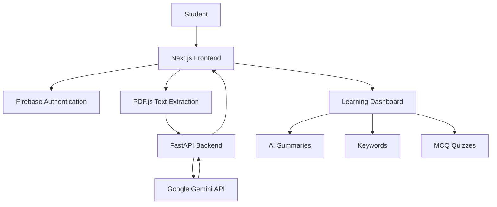

# SKIMLY — MTJ Edition

### Your Personal AI-Powered Learning Ecosystem

<p align="center">
  <strong>Study Smarter. Learn Better. Remember More.</strong>
</p>

<p align="center">
  An intelligent study companion that transforms static academic PDFs into interactive, AI-powered learning experiences.
</p>

<p align="center">
  
  
  
  
  
  
</p>

---

## Overview

**SKIMLY** is an AI-powered academic productivity platform designed to simplify the way students study, revise, and retain information.

Traditional studying often involves navigating lengthy PDFs, manually preparing notes, and creating practice questions. SKIMLY streamlines this process by combining document processing, generative AI, and an intuitive learning interface into one unified platform.

Upload your study material, let AI understand the content, and turn it into structured learning resources within seconds.

## Why SKIMLY?

| Traditional Studying | With SKIMLY |
|---|---|
| Manually reading lengthy PDFs | AI-assisted content understanding |
| Preparing notes from scratch | Structured AI-generated summaries |
| Searching for important concepts | Automatic keyword extraction |
| Creating practice questions manually | AI-generated MCQ quizzes |
| Managing resources across platforms | Centralized learning workspace |

---

## Core Features

### 01. AI-Powered Summarization
Convert lengthy academic documents into organized, readable summaries using Google Gemini.

- Context-aware content processing
- Structured Markdown output
- Simplified explanations of complex concepts
- Reduced time spent preparing notes

### 02. Intelligent Keyword Extraction
Automatically identify important concepts and terminology from uploaded documents.

- Extract key terms
- Highlight important concepts
- Support faster revision

### 03. AI-Generated Quizzes
Test your understanding through automatically generated multiple-choice questions.

- 10 MCQs per generated quiz
- AI-powered question generation
- Limited to 3 quiz generations per PDF

### 04. Secure Authentication
User registration and login powered by Firebase Authentication.

- Email and password authentication
- Protected dashboard navigation
- User-specific login sessions

### 05. Centralized Learning Dashboard
A unified workspace to access different learning modules.

- Dashboard
- My Library
- AI Summaries
- Flashcards
- Quizzes
- Video Learning
- Community

### 06. Flashcards & Revision
A dedicated flashcard module planned for premium learning experiences.

<sub>Premium feature — Coming Soon.</sub>

---

## Application Architecture

SKIMLY follows a frontend-backend architecture with separate responsibilities for the user interface, API processing, authentication, and AI generation.



### Workflow

1. The user authenticates through Firebase.
2. A PDF document is uploaded through the dashboard.
3. PDF.js extracts the document's text.
4. The frontend sends extracted content to the FastAPI backend.
5. FastAPI processes the request and communicates with Google Gemini.
6. AI-generated results are returned to the frontend.
7. Summaries, keywords, and quizzes are presented through the dashboard.

---

## Technology Stack

| Layer | Technology | Purpose |
|---|---|---|
| Frontend Framework | Next.js 16 | Application architecture |
| UI Library | React | Component-based interface |
| Language | TypeScript | Type-safe frontend development |
| Styling | Tailwind CSS | Responsive interface styling |
| Backend | Python | Server-side processing |
| API Framework | FastAPI | REST API development |
| AI Engine | Google Gemini API | Generative AI capabilities |
| Authentication | Firebase Auth | User authentication |
| PDF Processing | PDF.js | Client-side PDF text extraction |
| Markdown Rendering | React Markdown | Structured summary display |

---

## Project Structure

```text
skimly-mtj-edition/
│
├── backend/
│   ├── main.py
│   ├── requirements.txt
│   ├── .env
│   └── ...
│
├── src/
│   ├── app/
│   │   ├── login/
│   │   ├── signup/
│   │   ├── page.tsx
│   │   ├── layout.tsx
│   │   └── globals.css
│   │
│   └── lib/
│       ├── firebase.ts
│       └── skimly-api.ts
│
├── public/
├── .gitignore
├── package.json
├── tsconfig.json
└── README.md
```

---

## Getting Started

Follow these instructions to run SKIMLY locally.

### Prerequisites

Make sure you have the following installed:

- Node.js (LTS)
- npm
- Python 3.10+
- Git
- A Google Gemini API key
- A Firebase project with Email/Password Authentication enabled

### 1. Clone the repository

```bash
git clone https://github.com/YOUR-USERNAME/skimly-mtj-edition.git

cd skimly-mtj-edition
```

### 2. Install frontend dependencies

```bash
npm install
```

### 3. Configure frontend environment variables

Create `.env.local` in the project root.

```env
NEXT_PUBLIC_API_URL=http://127.0.0.1:8000

NEXT_PUBLIC_FIREBASE_API_KEY=your_api_key
NEXT_PUBLIC_FIREBASE_AUTH_DOMAIN=your_auth_domain
NEXT_PUBLIC_FIREBASE_PROJECT_ID=your_project_id
NEXT_PUBLIC_FIREBASE_STORAGE_BUCKET=your_storage_bucket
NEXT_PUBLIC_FIREBASE_MESSAGING_SENDER_ID=your_sender_id
NEXT_PUBLIC_FIREBASE_APP_ID=your_app_id
```

### 4. Configure the backend

```bash
cd backend
```

Create a virtual environment:

```bash
python -m venv venv
```

Activate it on Windows:

```bash
venv\Scripts\activate
```

Install Python dependencies:

```bash
pip install -r requirements.txt
```

Create a `.env` file inside the backend directory:

```env
GEMINI_API_KEY=your_gemini_api_key
```

### 5. Run the backend

```bash
uvicorn main:app --reload --host 127.0.0.1 --port 8000
```

Backend URL:

`http://127.0.0.1:8000`

Interactive API documentation:

`http://127.0.0.1:8000/docs`

### 6. Run the frontend

Open another terminal at the project root:

```bash
npm run dev
```

Frontend URL:

`http://localhost:3000`

---

## API Reference

The FastAPI backend exposes the following endpoints:

| Method | Endpoint | Description |
|---|---|---|
| GET | `/` | Backend welcome endpoint |
| GET | `/health` | Health check |
| POST | `/keywords` | Extract important keywords |
| POST | `/summary` | Generate AI summaries |
| POST | `/quiz` | Generate MCQ quizzes |

### Example API Request

```json
{
  "text": "Your extracted academic PDF content...",
  "pdf_id": "document_001"
}
```

### Example API Usage

```python
import requests

response = requests.post(
    "http://127.0.0.1:8000/summary",
    json={
        "text": "Your academic content...",
        "pdf_id": "document_001"
    }
)

print(response.json())
```

---

## Screenshots

Add actual application screenshots here after deployment.

| Dashboard | AI Summaries |
|---|---|
| Add dashboard screenshot | Add summary screenshot |

| Quiz Module | Authentication |
|---|---|
| Add quiz screenshot | Add login screenshot |

---

## Security & Configuration

- Environment files are excluded from Git version control.
- Firebase Authentication manages user sign-in.
- Gemini API credentials are stored in backend environment variables.
- Frontend and backend communicate through configurable API URLs.
- CORS must be configured for trusted frontend origins.

**Note:** Frontend authentication alone does not secure backend endpoints. Production deployments should verify Firebase ID tokens on protected backend routes.

---

## Roadmap

- [x] Next.js application setup
- [x] Responsive learning dashboard
- [x] Firebase email/password authentication
- [x] PDF text extraction
- [x] Gemini-powered AI summaries
- [x] Automatic keyword extraction
- [x] AI-generated MCQ quizzes
- [ ] Advanced flashcard generation
- [ ] Video recommendations
- [ ] Collaborative learning community
- [ ] Personalized learning analytics
- [ ] Enhanced document library management

---

## Future Vision

SKIMLY aims to evolve into a comprehensive AI learning ecosystem where students can organize academic resources, generate personalized learning material, evaluate their understanding, and improve their study efficiency through intelligent assistance.

---

## Author

**Tanvi Sharma**

B.Tech Computer Science and Engineering — AIML  
Manipal University Jaipur

[GitHub Profile](https://github.com/YOUR-USERNAME)

---

<p align="center">
  <strong>SKIMLY — Study Smarter. Learn Better.</strong>
  <br/>
  Built to make learning more intelligent, accessible, and efficient.
</p>